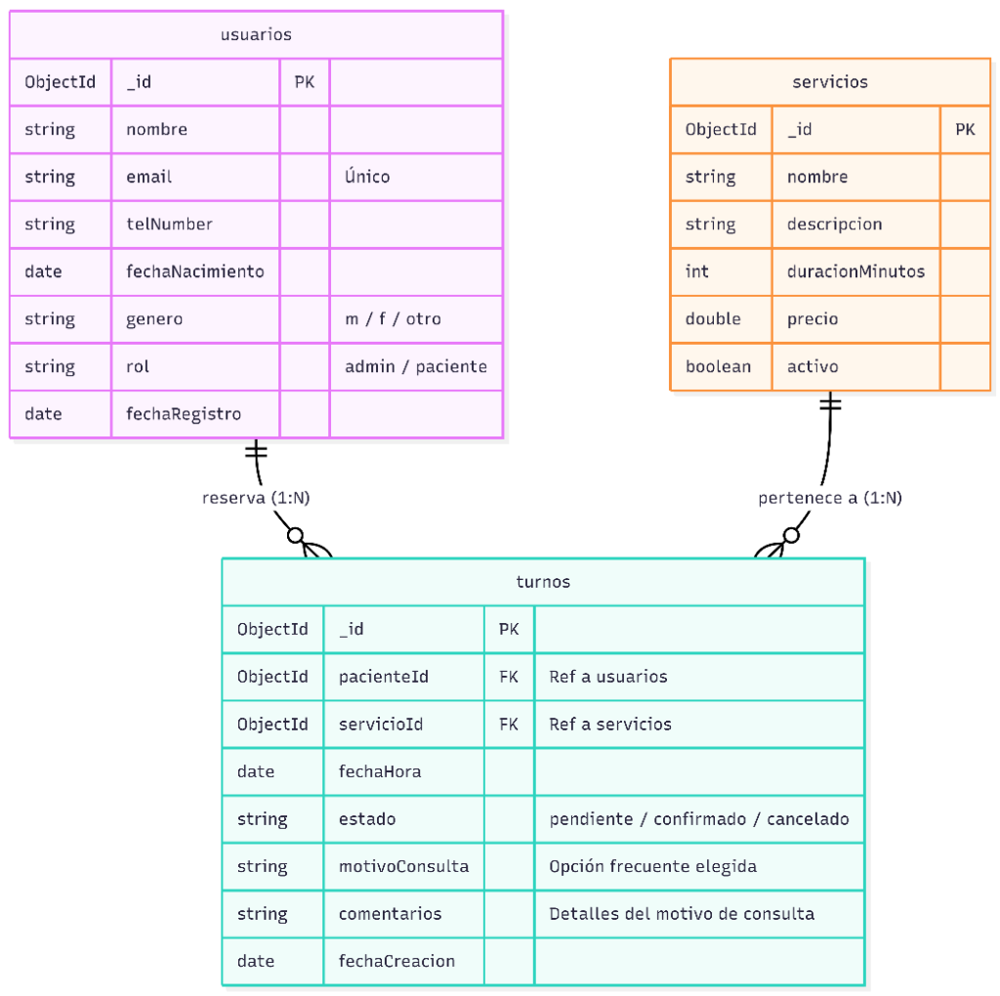
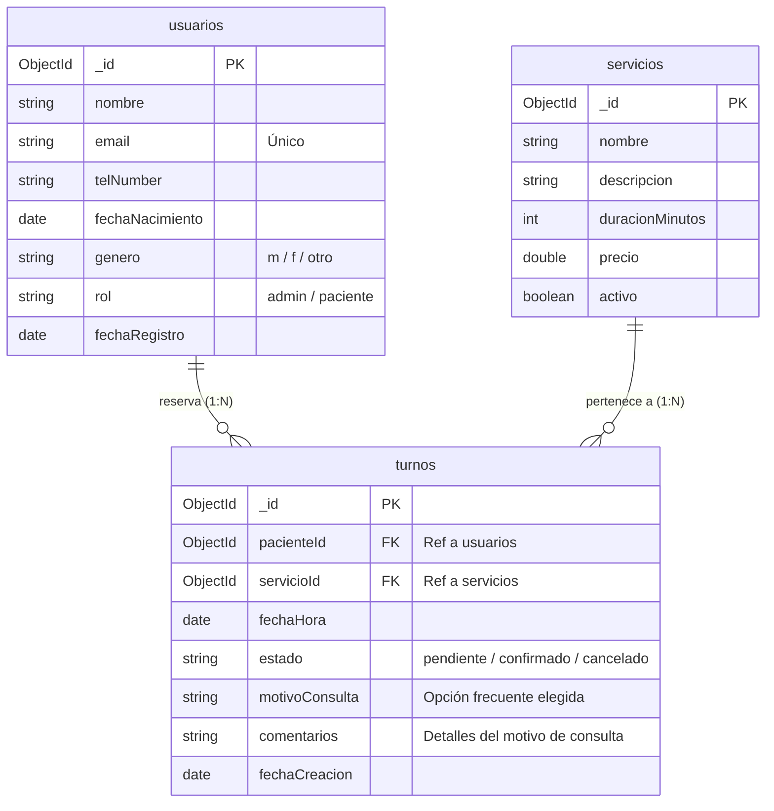

# Evaluación Bases de Datos: Diseño de Esquema
**Curso Avanzado: Desarrollo Back-End — Universidad Tecnológica Nacional (UTN)**

---

## 1. Elección del dominio

El dominio seleccionado corresponde a **En-Joy Psicopedagogía**, un sistema de gestión de consultas y turnos para un consultorio psicopedagógico. 

* **Descripción del negocio:** La aplicación web permite a la psicopedagoga (Administradora) gestionar su agenda de turnos y el catálogo de servicios terapéuticos ofrecidos, y a los pacientes/tutores (Usuarios clientes) registrarse, consultar la disponibilidad y reservar/solicitar turnos para sesiones de psicopedagogía.

---

## 2. Diagrama del modelo

A continuación, se representa el esquema del modelo de datos para una base de datos NoSQL orientada a documentos (MongoDB) utilizando la notación de diagrama Entidad-Relación (ER):

### Imagen del Diagrama del Modelo


### Código del Diagrama (Mermaid)



### Relaciones:
- **Usuario $\leftrightarrow$ Turno (Relación 1:N):** Un usuario (paciente) puede agendar múltiples turnos a lo largo de su tratamiento. Cada turno pertenece a un único paciente.
- **Servicio $\leftrightarrow$ Turno (Relación 1:N):** Un servicio psicopedagógico específico (ej. *Estimulación Cognitiva*) puede ser asignado a muchos turnos de diferentes pacientes. Cada turno corresponde a un único tipo de servicio seleccionado.

---

## 3. Justificación de embeber vs. referenciar

En el diseño de nuestro esquema en MongoDB, hemos tomado decisiones de diseño orientadas a la consistencia del negocio y el rendimiento de las consultas:

### A. Referenciar la Entidad "Servicio" en "Turno" (Referenciación)
* **Decisión:** La entidad **Servicio** se almacena en una colección independiente (`servicios`) y es referenciada en los turnos a través del campo `servicioId`.
* **Justificación:** Los servicios son registros maestros que cambian de precio, descripción o duración de forma centralizada. Si embebiéramos el servicio completo dentro de cada documento de turno, la modificación del precio de un servicio crearía una inconsistencia histórica en turnos ya facturados o generaría datos duplicados innecesariamente complejos de actualizar. Además, la colección de servicios se consulta frecuentemente por separado en el frontend para mostrar el portafolio (Galería/Servicios) de manera independiente de los turnos agendados.

### B. Referenciar la Entidad "Usuario" en "Turno" (Referenciación)
* **Decisión:** Los datos del paciente se referencian mediante `pacienteId` en la colección `turnos`.
* **Justificación:** Un paciente asiste de forma recurrente al consultorio. Embeber todos sus datos personales (nombre, teléfono, fecha de nacimiento, género) dentro de cada turno provocaría una redundancia masiva de datos y dificultaría la actualización del perfil del paciente (por ejemplo, si cambia de número de teléfono). 

### C. Embeber datos de auditoría e historial (Embebido)
* **Decisión:** En caso de necesitar almacenar notas de evolución clínica de cada sesión, estas se embeberían directamente en un arreglo `evoluciones` dentro del documento del `turno` correspondiente (ej: `[ { fecha: Date, notas: String } ]`).
* **Justificación:** Las notas de evolución clínica pertenecen única y exclusivamente a ese turno/sesión en particular, no son compartidas ni reutilizadas por otras entidades del sistema, y siempre se leen en conjunto con el detalle del turno.

---

## 4. Índices propuestos

Para asegurar la escalabilidad del sistema y optimizar la velocidad de respuesta, se definen los siguientes índices:

1. **Índice único en `usuarios.email` `{ "email": 1 }, { unique: true }`**
   * *Propósito:* Garantiza que no existan cuentas duplicadas con el mismo correo electrónico y acelera el inicio de sesión y registro de los usuarios.
2. **Índice simple en `turnos.pacienteId` `{ "pacienteId": 1 }`**
   * *Propósito:* Optimiza las consultas del panel del paciente cuando éste solicita ver su historial personal de turnos.
3. **Índice compuesto en `turnos.fechaHora` y `turnos.estado` `{ "fechaHora": 1, "estado": 1 }`**
   * *Propósito:* Acelera la búsqueda de la psicopedagoga para obtener la agenda diaria de turnos confirmados y futuros, filtrando rápidamente por fechas y estados activos.

---

## 5. Documentos de ejemplo

A continuación se presentan los documentos JSON de prueba para validar el diseño del esquema. Las referencias son coherentes entre sí:

### Colección: `usuarios`
```json
[
  {
    "_id": { "$oid": "60d5ec481f3c882b548b4561" },
    "nombre": "Joana Reche",
    "email": "joyreche@gmail.com",
    "telNumber": "+543364206772",
    "fechaNacimiento": { "$date": "1994-05-12T00:00:00Z" },
    "genero": "f",
    "rol": "admin",
    "fechaRegistro": { "$date": "2026-01-10T12:00:00Z" }
  },
  {
    "_id": { "$oid": "60d5ec481f3c882b548b4562" },
    "nombre": "Martín Pérez",
    "email": "martinperez@gmail.com",
    "telNumber": "+543364112233",
    "fechaNacimiento": { "$date": "2018-08-20T00:00:00Z" },
    "genero": "m",
    "rol": "paciente",
    "fechaRegistro": { "$date": "2026-08-15T09:30:00Z" }
  },
  {
    "_id": { "$oid": "60d5ec481f3c882b548b4563" },
    "nombre": "Sofía Rodríguez",
    "email": "sofiarodriguez@gmail.com",
    "telNumber": "+543364998877",
    "fechaNacimiento": { "$date": "2016-03-14T00:00:00Z" },
    "genero": "f",
    "rol": "paciente",
    "fechaRegistro": { "$date": "2026-08-20T11:15:00Z" }
  }
]
```

### Colección: `servicios`
```json
[
  {
    "_id": { "$oid": "60d5ed291f3c882b548b4571" },
    "nombre": "Estimulación Cognitiva",
    "descripcion": "Ejercicios de estimulación cognitiva matemática y razonamiento lógico lúdico.",
    "duracionMinutos": 45,
    "precio": 8500.0,
    "activo": true
  },
  {
    "_id": { "$oid": "60d5ed291f3c882b548b4572" },
    "nombre": "Alfabetización Lúdica",
    "descripcion": "Acompañamiento en el proceso de lectoescritura mediante metodologías de juego.",
    "duracionMinutos": 50,
    "precio": 9000.0,
    "activo": true
  },
  {
    "_id": { "$oid": "60d5ed291f3c882b548b4573" },
    "nombre": "Taller Educativo Grupal",
    "descripcion": "Taller educativo de habilidades sociales y recreación guiada en grupos reducidos.",
    "duracionMinutos": 90,
    "precio": 6500.0,
    "activo": true
  }
]
```

### Colección: `turnos`
```json
[
  {
    "_id": { "$oid": "60d5ee111f3c882b548b4581" },
    "pacienteId": { "$oid": "60d5ec481f3c882b548b4562" },
    "servicioId": { "$oid": "60d5ed291f3c882b548b4571" },
    "fechaHora": { "$date": "2026-09-01T15:00:00Z" },
    "estado": "confirmado",
    "motivoConsulta": "Desafíos en el cálculo matemático y razonamiento lógico (discalculia)",
    "comentarios": "Deseo agendar la primera consulta para diagnóstico de problemas de concentración en matemática escolar.",
    "fechaCreacion": { "$date": "2026-08-27T10:00:00Z" }
  },
  {
    "_id": { "$oid": "60d5ee111f3c882b548b4582" },
    "pacienteId": { "$oid": "60d5ec481f3c882b548b4563" },
    "servicioId": { "$oid": "60d5ed291f3c882b548b4572" },
    "fechaHora": { "$date": "2026-09-02T17:30:00Z" },
    "estado": "pendiente",
    "motivoConsulta": "Problemas en la adquisición de la lectoescritura (dislexia, retraso lector, dificultades de comprensión)",
    "comentarios": "Solicitud de turno para fortalecimiento de lectoescritura inicial en primer grado.",
    "fechaCreacion": { "$date": "2026-08-27T11:20:00Z" }
  }
]
```
