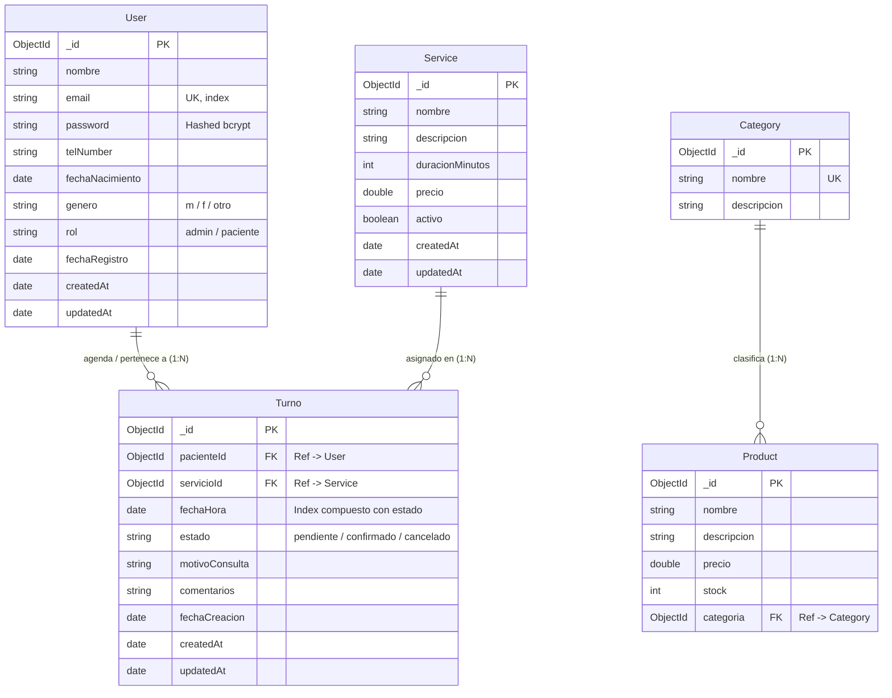

# API RESTful con CRUD y Capa de Servicios — En-Joy Psicopedagogía

> **Trabajo Práctico Final — Curso de Backend Developer**  
> **Centro de e-Learning UTN BA (Universidad Tecnológica Nacional)**  
> **Dominio:** En-Joy Psicopedagogía (Gestión Integral de Turnos, Servicios Terapéuticos y Usuarios)

---

## 3. Título y Breve Descripción del Proyecto

**En-Joy Psicopedagogía API** es una solución backend construida bajo la arquitectura RESTful en Node.js, Express y MongoDB (Mongoose), aplicando el patrón de **Separación de Responsabilidades** a través de una **Capa de Servicios (`services/`)**. 

El sistema provee una plataforma segura y escalable para:
1. **Autenticación y Autorización:** Registro público (rol `paciente` forzado por seguridad), inicio de sesión seguro con contraseñas encriptadas mediante `bcrypt` (en pre-save hooks) y generación/validación de `JSON Web Tokens (JWT)`.
2. **Gestión de Servicios Psicoterapéuticos:** CRUD completo para catálogo de prestaciones clínicas.
3. **Gestión de Turnos y Agenda de Consultas:** CRUD completo con relaciones referenciadas entre pacientes y servicios utilizando `.populate()` de Mongoose.
4. **Integración con Formulario Web:** Endpoint especializado para recepcionar solicitudes de admisión y turnos directamente desde el frontend institucional de En-Joy Psicopedagogía.
5. **Compatibilidad con Enunciado Base:** Modelos, servicios, controladores y rutas para `Productos` y `Categorías` con relaciones referenciadas mediante ObjectId y `populate`.

---

## 4. Esquema de la Base de Datos (Estructura de las Colecciones)

El diseño del esquema NoSQL está optimizado para la consistencia del dominio clínico psicopedagógico (conforme al diseño presentado en `EVALUACION_DISENO_DB.md`):



### Justificación de Relaciones y Poblado (`populate`)
- **Turnos $\leftrightarrow$ Usuarios y Servicios:** Se utiliza **referenciación** mediante `ObjectId` (`ref: 'User'` y `ref: 'Service'`). La psicopedagoga y el catálogo de servicios son entidades maestras; referenciarlas evita duplicaciones masivas y asegura que al modificar precios o datos del usuario, el historial no quede desfasado. En las operaciones de lectura `GET /api/turnos`, se ejecuta `.populate('pacienteId')` y `.populate('servicioId')` para devolver los datos completos asociados.
- **Productos $\leftrightarrow$ Categorías:** La entidad Producto guarda una referencia a Categoría (`ref: 'Category'`), resuelta mediante `.populate('categoria')`.

---

## 5. Listado de Tecnologías Utilizadas

- **Entorno de ejecución:** [Node.js](https://nodejs.org/) (v18+)
- **Framework Web:** [Express.js](https://expressjs.com/) (v4.x)
- **Base de Datos NoSQL:** [MongoDB](https://www.mongodb.com/)
- **ODM (Object Data Modeling):** [Mongoose](https://mongoosejs.com/) (v8.x)
- **Seguridad y Encriptación:** [bcryptjs](https://www.npmjs.com/package/bcryptjs) (hashing de contraseñas con salting en pre-save hooks)
- **Autenticación:** [jsonwebtoken (JWT)](https://jwt.io/) (tokens de acceso firmados)
- **Variables de Entorno:** [dotenv](https://www.npmjs.com/package/dotenv)
- **Middleware CORS:** [cors](https://www.npmjs.com/package/cors)
- **Logger HTTP:** [morgan](https://www.npmjs.com/package/morgan)
- **Recarga en vivo en desarrollo:** [nodemon](https://www.npmjs.com/package/nodemon)

---

## 6. Instrucciones Claras de Instalación y Ejecución

### Prerrequisitos
- Tener instalado **Node.js** (versión 18 o superior).
- Tener una instancia de **MongoDB** activa (local en `mongodb://127.0.0.1:27017` o una cuenta en **MongoDB Atlas**).

### Paso 1: Clonar o situarse en el repositorio
```bash
git clone https://github.com/JanoND2499/Sitio-Web-Psicopedagogia-JR.git
cd "Sitio-Web-Psicopedagogia-JR"
```

### Paso 2: Instalar las dependencias del backend
Desde la raíz del proyecto:
```bash
npm --prefix backend install
```
O ingresando al directorio `backend`:
```bash
cd backend
npm install
```

### Paso 3: Configurar variables de entorno
Cree su archivo `.env` dentro de la carpeta `backend` a partir de la plantilla:
```bash
cp .env.example .env
```
Asegúrese de configurar los valores obligatorios en `backend/.env`:
```env
PORT=5000
MONGO_URI=mongodb://127.0.0.1:27017/enjoy_psicopedagogia
JWT_SECRET=REEMPLAZAR_POR_UNA_CLAVE_SEGURA
JWT_EXPIRES_IN=24h
NODE_ENV=development
```
> **Nota de Seguridad:** La aplicación valida en el arranque la presencia obligatoria de `JWT_SECRET` y `MONGO_URI`. Si falta alguna de ellas, detiene la ejecución informando el error para evitar iniciar en modo inseguro.

### Paso 4: Poblar la base de datos con datos de prueba (Seed Mock)
Ejecute el script de sembrado para cargar automáticamente usuarios (con contraseñas ya hasheadas), servicios y turnos referenciados:
```bash
# Desde la carpeta backend:
npm run seed

# O desde la raíz del proyecto:
npm run backend:seed
```

### Paso 5: Iniciar el servidor
- **Modo Desarrollo (con recarga automática mediante nodemon):**
  ```bash
  npm run dev
  ```
- **Modo Producción:**
  ```bash
  npm start
  ```
El servidor backend quedará disponible en: `http://localhost:5000`.

---

## 7. Listado Completo de Endpoints Disponibles

### Autenticación y Usuarios (`/api/usuarios` o `/api/users`)
| Método | Endpoint | Acceso / Header Requerido | Descripción |
| :--- | :--- | :--- | :--- |
| `POST` | `/api/usuarios/register` | Público | Registra usuario (asigna rol `paciente` por defecto) y retorna JWT |
| `POST` | `/api/usuarios/login` | Público | Inicia sesión verificando credenciales con bcrypt y emite JWT |
| `GET` | `/api/usuarios` | Protegido (`verifyToken`, `verifyAdmin`) | Lista todos los usuarios registrados (exclusivo admin) |
| `GET` | `/api/usuarios/:id` | Protegido (`verifyToken`) | Obtiene detalle de un usuario por ID |
| `PUT` | `/api/usuarios/:id` | Protegido (`verifyToken`) | Actualiza datos (usuario propio o admin; solo admin cambia rol) |
| `DELETE` | `/api/usuarios/:id` | Protegido (`verifyToken`) | Elimina cuenta (propia o por admin) |

### Catálogo de Servicios (`/api/servicios` o `/api/services`)
| Método | Endpoint | Acceso / Header Requerido | Descripción |
| :--- | :--- | :--- | :--- |
| `GET` | `/api/servicios` | Público | Lista todos los servicios (`?activo=true&search=...`) |
| `GET` | `/api/servicios/:id` | Público | Obtiene el detalle de un servicio por su ID |
| `POST` | `/api/servicios` | Protegido (`Authorization: Bearer <token>`) | Crea un nuevo servicio clínico |
| `PUT` | `/api/servicios/:id` | Protegido (`Authorization: Bearer <token>`) | Actualiza precio, duración o estado de un servicio |
| `DELETE` | `/api/servicios/:id` | Protegido (`Authorization: Bearer <token>`) | Elimina un servicio |

### Gestión de Turnos (`/api/turnos`)
| Método | Endpoint | Acceso / Header Requerido | Descripción |
| :--- | :--- | :--- | :--- |
| `POST` | `/api/turnos/solicitar` | Público (Frontend Web) | Crea/vincula paciente y agenda turno desde el formulario web |
| `GET` | `/api/turnos` | Protegido (`Authorization: Bearer <token>`) | Lista turnos con `.populate('pacienteId', 'servicioId')` |
| `GET` | `/api/turnos/:id` | Protegido (`Authorization: Bearer <token>`) | Obtiene un turno por ID con sus datos referenciados |
| `POST` | `/api/turnos` | Protegido (`Authorization: Bearer <token>`) | Crea un turno vinculando `pacienteId` y `servicioId` |
| `PUT` | `/api/turnos/:id` | Protegido (`Authorization: Bearer <token>`) | Actualiza turno (ej. de 'pendiente' a 'confirmado') |
| `DELETE` | `/api/turnos/:id` | Protegido (`Authorization: Bearer <token>`) | Cancela / elimina un turno |

### Productos y Categorías (Enunciado Clásico: `/api/productos`, `/api/categorias`)
| Método | Endpoint | Acceso / Header Requerido | Descripción |
| :--- | :--- | :--- | :--- |
| `GET` | `/api/categorias` | Público | Lista todas las categorías |
| `GET` | `/api/categorias/:id` | Público | Detalle de una categoría por ID |
| `POST` | `/api/categorias` | Protegido (`Authorization: Bearer <token>`) | Crea una categoría |
| `PUT` | `/api/categorias/:id` | Protegido (`Authorization: Bearer <token>`) | Actualiza una categoría |
| `DELETE` | `/api/categorias/:id` | Protegido (`Authorization: Bearer <token>`) | Elimina una categoría |
| `GET` | `/api/productos` | Público | Lista productos con `.populate('categoria')` |
| `GET` | `/api/productos/:id` | Público | Detalle de un producto con categoría poblada |
| `POST` | `/api/productos` | Protegido (`Authorization: Bearer <token>`) | Crea un producto validando su categoría |
| `PUT` | `/api/productos/:id` | Protegido (`Authorization: Bearer <token>`) | Actualiza un producto |
| `DELETE` | `/api/productos/:id` | Protegido (`Authorization: Bearer <token>`) | Elimina un producto |

---

## 8. Ejemplos de Datos Mock (Formato JSON) para Todas las Solicitudes

### Formato del Header de Autorización
Para todas las rutas protegidas, incluir en la cabecera HTTP:
```http
Authorization: Bearer <token_jwt_aqui>
```

---

### A. Autenticación y Usuarios

#### 1. Registro de Usuario (`POST /api/usuarios/register`)
> **Seguridad:** El backend siempre fuerza `rol: 'paciente'` ignorando cualquier rol que se intente enviar en el body.
**Request:**
```json
{
  "nombre": "Carolina Gómez",
  "email": "carolina.gomez@gmail.com",
  "password": "Password123!",
  "telNumber": "+543364556677",
  "fechaNacimiento": "1992-07-15",
  "genero": "f"
}
```
**Response (201 Created):**
```json
{
  "success": true,
  "message": "Usuario registrado exitosamente",
  "data": {
    "user": {
      "_id": "6724a1b2c3d4e5f6a7b8c9d0",
      "nombre": "Carolina Gómez",
      "email": "carolina.gomez@gmail.com",
      "telNumber": "+543364556677",
      "fechaNacimiento": "1992-07-15T00:00:00.000Z",
      "genero": "f",
      "rol": "paciente",
      "fechaRegistro": "2026-10-31T12:00:00.000Z"
    },
    "token": "eyJhbGciOiJIUzI1NiIsInR5cCI6IkpXVCJ9..."
  }
}
```

#### 2. Inicio de Sesión / Login (`POST /api/usuarios/login`)
**Request:**
```json
{
  "email": "joyreche@gmail.com",
  "password": "AdminPassword123!"
}
```
**Response (200 OK):**
```json
{
  "success": true,
  "message": "Inicio de sesión exitoso",
  "data": {
    "user": {
      "_id": "60d5ec481f3c882b548b4561",
      "nombre": "Joana Reche",
      "email": "joyreche@gmail.com",
      "rol": "admin"
    },
    "token": "eyJhbGciOiJIUzI1NiIsInR5cCI6IkpXVCJ9..."
  }
}
```

---

### B. CRUD de Servicios

#### 1. Obtener Servicios (`GET /api/servicios`)
**Response (200 OK):**
```json
{
  "success": true,
  "count": 1,
  "data": [
    {
      "_id": "60d5ed291f3c882b548b4571",
      "nombre": "Estimulación Cognitiva",
      "descripcion": "Ejercicios de estimulación cognitiva matemática y razonamiento lógico lúdico.",
      "duracionMinutos": 45,
      "precio": 8500,
      "activo": true
    }
  ]
}
```

#### 2. Crear Servicio (`POST /api/servicios`) — Header: `Authorization: Bearer <token>`
**Request:**
```json
{
  "nombre": "Evaluación Psicopedagógica Integral",
  "descripcion": "Batería de pruebas neuropsicológicas y de aprendizaje.",
  "duracionMinutos": 60,
  "precio": 12000,
  "activo": true
}
```
**Response (201 Created):**
```json
{
  "success": true,
  "message": "Servicio creado exitosamente",
  "data": {
    "_id": "6724b1112233445566778899",
    "nombre": "Evaluación Psicopedagógica Integral",
    "descripcion": "Batería de pruebas neuropsicológicas y de aprendizaje.",
    "duracionMinutos": 60,
    "precio": 12000,
    "activo": true
  }
}
```

#### 3. Actualizar Servicio (`PUT /api/servicios/:id`) — Header: `Authorization: Bearer <token>`
**Request:**
```json
{
  "precio": 13500,
  "activo": true
}
```
**Response (200 OK):**
```json
{
  "success": true,
  "message": "Servicio actualizado exitosamente",
  "data": {
    "_id": "6724b1112233445566778899",
    "nombre": "Evaluación Psicopedagógica Integral",
    "precio": 13500,
    "duracionMinutos": 60,
    "activo": true
  }
}
```

#### 4. Eliminar Servicio (`DELETE /api/servicios/:id`) — Header: `Authorization: Bearer <token>`
**Response (200 OK):**
```json
{
  "success": true,
  "message": "Servicio eliminado exitosamente",
  "id": "6724b1112233445566778899"
}
```

---

### C. CRUD de Turnos (Relación con Paciente y Servicio via `populate`)

#### 1. Crear Turno vinculando IDs (`POST /api/turnos`) — Header: `Authorization: Bearer <token>`
**Request:**
```json
{
  "pacienteId": "60d5ec481f3c882b548b4562",
  "servicioId": "60d5ed291f3c882b548b4571",
  "fechaHora": "2026-11-15T16:00:00.000Z",
  "motivoConsulta": "Desafíos en el cálculo matemático y razonamiento lógico",
  "comentarios": "Segunda sesión diagnóstica"
}
```
**Response (201 Created con Populate):**
```json
{
  "success": true,
  "message": "Turno creado exitosamente",
  "data": {
    "_id": "6724c9988776655443322155",
    "fechaHora": "2026-11-15T16:00:00.000Z",
    "estado": "pendiente",
    "motivoConsulta": "Desafíos en el cálculo matemático y razonamiento lógico",
    "comentarios": "Segunda sesión diagnóstica",
    "pacienteId": {
      "_id": "60d5ec481f3c882b548b4562",
      "nombre": "Martín Pérez",
      "email": "martinperez@gmail.com",
      "telNumber": "+543364112233"
    },
    "servicioId": {
      "_id": "60d5ed291f3c882b548b4571",
      "nombre": "Estimulación Cognitiva",
      "precio": 8500,
      "duracionMinutos": 45
    }
  }
}
```

#### 2. Consultar Turnos con Populate (`GET /api/turnos`) — Header: `Authorization: Bearer <token>`
**Response (200 OK):**
```json
{
  "success": true,
  "count": 1,
  "data": [
    {
      "_id": "60d5ee111f3c882b548b4581",
      "fechaHora": "2026-09-01T15:00:00.000Z",
      "estado": "confirmado",
      "motivoConsulta": "Desafíos en el cálculo matemático y razonamiento lógico",
      "comentarios": "Primera consulta para diagnóstico.",
      "pacienteId": {
        "_id": "60d5ec481f3c882b548b4562",
        "nombre": "Martín Pérez",
        "email": "martinperez@gmail.com",
        "telNumber": "+543364112233",
        "fechaNacimiento": "2018-08-20T00:00:00.000Z",
        "genero": "m"
      },
      "servicioId": {
        "_id": "60d5ed291f3c882b548b4571",
        "nombre": "Estimulación Cognitiva",
        "descripcion": "Ejercicios de estimulación cognitiva matemática y razonamiento lógico lúdico.",
        "duracionMinutos": 45,
        "precio": 8500,
        "activo": true
      }
    }
  ]
}
```

#### 3. Actualizar Turno (`PUT /api/turnos/:id`) — Header: `Authorization: Bearer <token>`
**Request:**
```json
{
  "estado": "confirmado",
  "comentarios": "Turno confirmado telefónicamente con la madre"
}
```
**Response (200 OK):**
```json
{
  "success": true,
  "message": "Turno actualizado exitosamente",
  "data": {
    "_id": "60d5ee111f3c882b548b4581",
    "estado": "confirmado",
    "comentarios": "Turno confirmado telefónicamente con la madre",
    "pacienteId": {
      "_id": "60d5ec481f3c882b548b4562",
      "nombre": "Martín Pérez"
    },
    "servicioId": {
      "_id": "60d5ed291f3c882b548b4571",
      "nombre": "Estimulación Cognitiva"
    }
  }
}
```

#### 4. Eliminar / Cancelar Turno (`DELETE /api/turnos/:id`) — Header: `Authorization: Bearer <token>`
**Response (200 OK):**
```json
{
  "success": true,
  "message": "Turno eliminado exitosamente",
  "id": "60d5ee111f3c882b548b4581"
}
```

---

### D. CRUD de Categorías

#### 1. Obtener Categorías (`GET /api/categorias`)
**Response (200 OK):**
```json
{
  "success": true,
  "count": 1,
  "data": [
    {
      "_id": "6724d1112233445566778801",
      "nombre": "Material Didáctico",
      "descripcion": "Juegos didácticos para psicopedagogía"
    }
  ]
}
```

#### 2. Crear Categoría (`POST /api/categorias`) — Header: `Authorization: Bearer <token>`
**Request:**
```json
{
  "nombre": "Evaluación Diagnóstica",
  "descripcion": "Instrumentos estandarizados de diagnóstico clínico"
}
```
**Response (201 Created):**
```json
{
  "success": true,
  "message": "Categoría creada exitosamente",
  "data": {
    "_id": "6724d1112233445566778802",
    "nombre": "Evaluación Diagnóstica",
    "descripcion": "Instrumentos estandarizados de diagnóstico clínico"
  }
}
```

#### 3. Actualizar Categoría (`PUT /api/categorias/:id`) — Header: `Authorization: Bearer <token>`
**Request:**
```json
{
  "descripcion": "Protocolos actualizados para evaluación escolar"
}
```
**Response (200 OK):**
```json
{
  "success": true,
  "message": "Categoría actualizada exitosamente",
  "data": {
    "_id": "6724d1112233445566778802",
    "nombre": "Evaluación Diagnóstica",
    "descripcion": "Protocolos actualizados para evaluación escolar"
  }
}
```

#### 4. Eliminar Categoría (`DELETE /api/categorias/:id`) — Header: `Authorization: Bearer <token>`
**Response (200 OK):**
```json
{
  "success": true,
  "message": "Categoría eliminada exitosamente",
  "id": "6724d1112233445566778802"
}
```

---

### E. CRUD de Productos (con referencia y `populate` de Categoría)

#### 1. Crear Producto (`POST /api/productos`) — Header: `Authorization: Bearer <token>`
**Request:**
```json
{
  "nombre": "Kit de Memotest Emocional",
  "descripcion": "Juego de cartas para expresión de emociones en sesión",
  "precio": 5200,
  "stock": 20,
  "categoria": "6724d1112233445566778801"
}
```
**Response (201 Created con Populate):**
```json
{
  "success": true,
  "message": "Producto creado exitosamente",
  "data": {
    "_id": "6724e1112233445566778803",
    "nombre": "Kit de Memotest Emocional",
    "descripcion": "Juego de cartas para expresión de emociones en sesión",
    "precio": 5200,
    "stock": 20,
    "categoria": {
      "_id": "6724d1112233445566778801",
      "nombre": "Material Didáctico",
      "descripcion": "Juegos didácticos para psicopedagogía"
    }
  }
}
```

#### 2. Obtener Productos con Populate (`GET /api/productos`)
**Response (200 OK):**
```json
{
  "success": true,
  "count": 1,
  "data": [
    {
      "_id": "6724e1112233445566778803",
      "nombre": "Kit de Memotest Emocional",
      "descripcion": "Juego de cartas para expresión de emociones en sesión",
      "precio": 5200,
      "stock": 20,
      "categoria": {
        "_id": "6724d1112233445566778801",
        "nombre": "Material Didáctico",
        "descripcion": "Juegos didácticos para psicopedagogía"
      }
    }
  ]
}
```

#### 3. Actualizar Producto (`PUT /api/productos/:id`) — Header: `Authorization: Bearer <token>`
**Request:**
```json
{
  "precio": 5600,
  "stock": 18
}
```
**Response (200 OK):**
```json
{
  "success": true,
  "message": "Producto actualizado exitosamente",
  "data": {
    "_id": "6724e1112233445566778803",
    "nombre": "Kit de Memotest Emocional",
    "precio": 5600,
    "stock": 18,
    "categoria": {
      "_id": "6724d1112233445566778801",
      "nombre": "Material Didáctico"
    }
  }
}
```

#### 4. Eliminar Producto (`DELETE /api/productos/:id`) — Header: `Authorization: Bearer <token>`
**Response (200 OK):**
```json
{
  "success": true,
  "message": "Producto eliminado exitosamente",
  "id": "6724e1112233445566778803"
}
```

---

### F. Manejo Estándar de Errores y Códigos HTTP

La API implementa respuestas de error normalizadas en formato JSON:

#### Error 400 Bad Request (Parámetro faltante o ID con formato inválido)
```json
{
  "success": false,
  "message": "El formato del ID 'id-invalido-123' no es válido"
}
```

#### Error 401 Unauthorized (Sin token o token expirado)
```json
{
  "success": false,
  "message": "Acceso no autorizado: No se proporcionó un token o el formato es inválido (Bearer <token>)"
}
```

#### Error 403 Forbidden (Permisos insuficientes)
```json
{
  "success": false,
  "message": "Acceso denegado: Se requieren permisos de Administrador."
}
```

#### Error 404 Not Found (Recurso no encontrado)
```json
{
  "success": false,
  "message": "Servicio con id '60d5ed291f3c882b548b9999' no encontrado"
}
```

#### Error 500 Internal Server Error (Falta de variable obligatoria o error no controlado)
```json
{
  "success": false,
  "message": "Error de configuración del servidor: JWT_SECRET no está configurada"
}
```

---

## 9. Funcionalidades Implementadas y a Futuro

### Funcionalidades Implementadas
- [x] Arquitectura en capas estrictas: Rutas $\rightarrow$ Controladores $\rightarrow$ Capa de Servicios $\rightarrow$ Modelos Mongoose.
- [x] CRUD completo para Servicios, Turnos, Usuarios, Productos y Categorías.
- [x] Hash seguro de contraseñas mediante `bcrypt` en hook pre-save de Mongoose.
- [x] Registro seguro de usuarios forzando rol `paciente` y restringiendo la edición de roles a administradores.
- [x] Autenticación mediante tokens JWT y middleware `verifyToken`.
- [x] Middleware `verifyAdmin` para operaciones privilegiadas.
- [x] Relaciones con integridad referencial y resolución de datos mediante `.populate()`.
- [x] Validación de formato de ObjectIds en todos los servicios (evita caídas 500 por CastError).
- [x] Manejo uniforme de respuestas HTTP con códigos apropiados (200, 201, 400, 401, 403, 404, 500) y manejo de excepciones mediante `try/catch`.
- [x] Habilitación de CORS para consumo directo desde SPA en React (Vite).
- [x] Script de sembrado inicial (`npm run seed`) con datos de prueba realistas.
- [x] Validación estricta en el arranque de variables obligatorias (`JWT_SECRET` y `MONGO_URI`).

### Funcionalidades a Futuro
- [ ] Recordatorios automatizados por correo electrónico (Nodemailer) y WhatsApp para turnos confirmados.
- [ ] Integración con pasarela de pagos (Mercado Pago / Stripe) para señar turnos en línea.
- [ ] Módulo de historia clínica con subida de informes psicopedagógicos en PDF (Amazon S3 / Cloudinary).
- [ ] Panel de métricas y gráficos estadísticos para la psicopedagoga (horas semanales, ingresos mensuales).

---

## 10. Archivo .env

Se provee una plantilla `backend/.env.example` con los parámetros necesarios:

```env
PORT=5000
MONGO_URI=mongodb://127.0.0.1:27017/enjoy_psicopedagogia
JWT_SECRET=REEMPLAZAR_POR_UNA_CLAVE_SEGURA
JWT_EXPIRES_IN=24h
NODE_ENV=development
```
